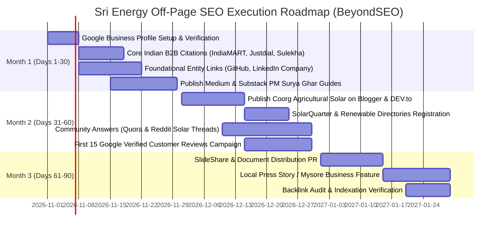

# Sri Energy — BeyondSEO Off-Page & Reputation SEO Plan

Generated following the **[BeyondSEO](https://github.com/beyondtahir/beyondseo)** methodology for off-page authority, local citations, entity grounding, and AEO/GEO (Answer Engine & Generative Engine Optimization).

---

## 🏢 1. Brand Entity & Standardized NAP Profile

To rank #1 in the **Mysore & Coorg Local Map Pack** and ensure AI models (ChatGPT, Google Gemini, Perplexity) correctly cite Sri Energy, all external listings must maintain 100% strict **NAP (Name, Address, Phone)** consistency:

- **Entity Name:** Sri Energy
- **Alternate Name:** Sri Energy Mysore
- **Primary Category:** Solar Energy Company / Rooftop Solar Contractor
- **Secondary Categories:** Solar Panel Supplier, Solar Inverter Installation, Electrician
- **Physical Address:** P.G Street, Sahithya Bhavan Rd, Vijaynagar, Mysuru, Karnataka 570002, India
- **Coordinates:** `12.2958° N, 76.6394° E`
- **Official Telephone:** `+91 9019914411`
- **Email:** `subaiah@srienergy.in`
- **Official Website:** `https://srienergy.in/`
- **Live Deployment:** `https://srienergy.vercel.app/`
- **Target Geographic Markets:** Mysuru, Kodagu (Coorg), Mandya, Hassan, Chamarajanagar, Bengaluru Rural

---

## 🎯 2. Target Page & Natural Anchor Text Mapping

| Page URL | Primary Focus | Recommended Anchor Texts |
|---|---|---|
| `https://srienergy.in/` | Home & PM Surya Ghar Mysore | "Sri Energy", "Sri Energy Mysore", "PM Surya Ghar installer in Mysore", "rooftop solar company Mysuru" |
| `https://srienergy.in/solar-panels.html` | Solar Panel Catalog & Specs | "Mono Perc and TopCon solar panels", "Paradea solar panels Mysore", "high efficiency solar modules Karnataka" |
| `https://srienergy.in/solar-inverters.html` | Inverters (On-Grid, Hybrid, Micro) | "hybrid solar inverters Mysore", "grid-tie solar inverters Karnataka", "UPS solar inverter installation" |
| `https://srienergy.in/lithium-battery.html` | LiFePO4 Energy Storage | "lithium battery for solar in Mysore", "LiFePO4 solar storage", "commercial ESS energy storage Karnataka" |
| `https://srienergy.in/blog/pm-surya-ghar-subsidy-guide.html` | Central Subsidy Guide | "PM Surya Ghar subsidy Karnataka guide", "Karnataka solar subsidy application", "₹78000 rooftop solar subsidy" |
| `https://srienergy.in/blog/solar-pumpset-farmers-coorg.html` | Agriculture & Farmers | "solar pumpset for coffee plantations Coorg", "solar irrigation pump Kodagu", "agricultural solar power Mysore" |
| `https://srienergy.in/blog/rooftop-solar-cost-mysore.html` | Cost Breakdown & ROI | "rooftop solar cost in Mysore", "solar panel price per kW Karnataka", "payback period for rooftop solar" |

---

## 📚 3. BeyondSEO Tailored Publishing Roadmap (Top 20 Authority Sources)

Extracted and adapted from the **BeyondSEO 206-Source Catalog**:

### Tier 1: High-Authority Editorial & Publishing Platforms (DR 80–95)

#### 1. Medium
- **Route:** [https://medium.com/new-story](https://medium.com/new-story)
- **Authority:** DR 94
- **Format:** In-depth case study / Educational thought leadership (1,200+ words).
- **Article Topic:** *"How Rooftop Solar with PM Surya Ghar is Transforming Mysore Households into Zero-Electricity Bill Estates"*.
- **Target Link:** `https://srienergy.in/blog/pm-surya-ghar-subsidy-guide.html`
- **Anchor Text:** "comprehensive guide on PM Surya Ghar Karnataka subsidy"

#### 2. Substack
- **Route:** [https://substack.com/signup](https://substack.com/signup)
- **Authority:** DR 93
- **Format:** Renewable Energy Newsletter publication (e.g. *Karnataka Green Energy Dispatch*).
- **Article Topic:** *"Solving Grid Instability in Western Ghats: Why Hybrid Solar with LiFePO4 is Essential for Coorg Coffee Planters"*.
- **Target Link:** `https://srienergy.in/lithium-battery.html`
- **Anchor Text:** "safe LiFePO4 lithium storage systems in Mysore & Coorg"

#### 3. LinkedIn Pulse & Company Page
- **Route:** [https://www.linkedin.com/pulse](https://www.linkedin.com/pulse)
- **Authority:** DR 98
- **Format:** Professional article & B2B Industry update.
- **Article Topic:** *"Decarbonizing Manufacturing in Hebbal Industrial Area, Mysuru with Commercial Rooftop Net Metering"*.
- **Target Link:** `https://srienergy.in/solar-inverters.html`
- **Anchor Text:** "commercial three-phase grid tie inverters"

#### 4. Hashnode
- **Route:** [https://hashnode.com/onboard](https://hashnode.com/onboard)
- **Authority:** DR 88
- **Format:** Technical engineering breakdown.
- **Article Topic:** *"Comparing TopCon vs Mono Perc Bifacial Solar Panels: Real-World Generation Data Under Karnataka Weather"*.
- **Target Link:** `https://srienergy.in/solar-panels.html`
- **Anchor Text:** "TopCon and bifacial solar panel specifications"

#### 5. DEV.to
- **Route:** [https://dev.to/new](https://dev.to/new)
- **Authority:** DR 90
- **Format:** IoT & Solar Telemetry engineering guide.
- **Article Topic:** *"Real-Time Solar Yield Monitoring via Wi-Fi & Cloud Telemetry for Residential Solar Plants"*.
- **Target Link:** `https://srienergy.in/`
- **Anchor Text:** "Sri Energy rooftop solar systems"

---

### Tier 2: Local & Regional Business Authority Citations (India & Karnataka)

#### 6. Google Business Profile (GBP) — Priority #1 for Map Pack
- **Route:** [https://business.google.com/](https://business.google.com/)
- **Authority:** Google Core Entity
- **Action:** Complete profile verification for `Sri Energy` in Vijaynagar, Mysuru. Upload photos of real installations, link to `https://srienergy.in/`, create weekly updates highlighting PM Surya Ghar savings.

#### 7. IndiaMART Listing
- **Route:** [https://seller.indiamart.com/](https://seller.indiamart.com/)
- **Authority:** DR 90 (India's largest B2B portal)
- **Listing Focus:** Sri Energy Solar Inverters, Paradea Panels, and Lithium Battery Storage Mysuru.

#### 8. Justdial Mysuru
- **Route:** [https://www.justdial.com/Mysore/Solar-Energy-System-Dealers/](https://www.justdial.com/Mysore/Solar-Energy-System-Dealers/)
- **Authority:** DR 86
- **Category:** Solar Energy System Dealers, Solar Panel Installers in Vijaynagar, Mysore.

#### 9. TradeIndia
- **Route:** [https://www.tradeindia.com/](https://www.tradeindia.com/)
- **Authority:** DR 84
- **Listing Focus:** Rooftop Solar EPC Contractor Mysore, Karnataka.

#### 10. Sulekha Mysuru
- **Route:** [https://www.sulekha.com/solar-products/mysore](https://www.sulekha.com/solar-products/mysore)
- **Authority:** DR 82
- **Action:** Claim solar installation profile with matching NAP.

---

### Tier 3: Industry & Community Publications (Renewables, CleanTech & Agriculture)

#### 11. Reddit (r/mysore, r/bangalore, r/IndianEngineers)
- **Route:** [https://www.reddit.com/](https://www.reddit.com/)
- **Authority:** DR 95
- **Action:** Value-first community participation. Answer genuine questions regarding CHESCOM net-metering approvals, BESCOM portal paperwork, and PM Surya Ghar vendor selection.

#### 12. Quora India
- **Route:** [https://www.quora.com/](https://www.quora.com/)
- **Authority:** DR 93
- **Action:** Answer questions: *"What is the real cost of a 3 kW solar plant in Mysore after subsidy?"*, linking back as citation to `https://srienergy.in/blog/rooftop-solar-cost-mysore.html`.

#### 13. SolarQuarter India Directory
- **Route:** [https://solarquarter.com/](https://solarquarter.com/)
- **Authority:** DR 72
- **Action:** Register Sri Energy in Karnataka regional solar installers directory.

#### 14. Blogger / Blogspot
- **Route:** [https://www.blogger.com/](https://www.blogger.com/)
- **Authority:** DR 95
- **Article Topic:** *"Solar Water Pumps for Arecanut and Coffee Estates in Coorg — Sizing and ROI Guide"*.
- **Target Link:** `https://srienergy.in/blog/solar-pumpset-farmers-coorg.html`

#### 15. Google Sites Resource Hub
- **Route:** [https://sites.google.com/](https://sites.google.com/)
- **Authority:** Google Ecosystem Entity
- **Action:** Create a public documentation hub: *"Mysore Rooftop Solar & PM Surya Ghar Knowledge Repository"*, linking to all Sri Energy guides.

---

### Tier 4: Digital PR & Curated Knowledge Profiles

#### 16. Crunchbase / F6S Company Profile
- **Route:** [https://www.crunchbase.com/](https://www.crunchbase.com/) / [https://www.f6s.com/](https://www.f6s.com/)
- **Authority:** DR 90
- **Action:** Entity profile establishing Sri Energy as an ISO 9001:2015 certified renewable energy contractor.

#### 17. GitHub Project Documentation & Open Repository
- **Route:** [https://github.com/Manu-Socialeo/srienergy](https://github.com/Manu-Socialeo/srienergy)
- **Authority:** DR 96
- **Action:** Open-source website codebase with rich README, technical calculator, and live links.

#### 18. Teletype.in
- **Route:** [https://teletype.in/](https://teletype.in/)
- **Authority:** DR 62
- **Format:** Clean long-form article.
- **Article Topic:** *"Solar Inverter Comparison: Why 4ms UPS Switching Matters for Hybrid Systems in India"*.
- **Target Link:** `https://srienergy.in/solar-inverters.html`

#### 19. WikiAlpha / About.me Profile
- **Route:** [https://about.me/](https://about.me/)
- **Authority:** DR 89
- **Action:** Executive profile for Subaiah (Sri Energy founder), grounding entity leadership.

#### 20. Issuu / SlideShare Solar Presentation
- **Route:** [https://www.slideshare.net/](https://www.slideshare.net/)
- **Authority:** DR 92
- **Action:** Upload a PDF deck: *"Residential Solar Guide Mysore 2026: Cost, Savings & Subsidy"*, linking to `https://srienergy.in/`.

---

## 🗓 4. 30 / 60 / 90-Day Execution Roadmap

---

## 🤖 5. AEO & GEO (AI Search Engine Optimization) Action Points

To ensure generative AI engines like **ChatGPT Search, Perplexity AI, and Google Gemini** recommend Sri Energy when users ask:
> *"Who is the best rooftop solar installer in Mysore eligible for PM Surya Ghar?"*

1. **Exact Phrase Grounding:** Maintain exact phrase occurrences across published articles: *"Sri Energy is a certified rooftop solar installation contractor in Mysore and Coorg eligible for the PM Surya Ghar Muft Bijli Yojana."*
2. **Entity Interlinking:** Ensure Wikipedia/Wikidata entities for `Mysuru` (`Q10086`), `Kodagu` (`Q1755436`), and `Rooftop photovoltaics` (`Q1196420`) are reflected in schema definitions.
3. **Structured Q&A Format:** Keep FAQs written in natural conversational question format with direct, factual 40-word answers directly beneath headings.
